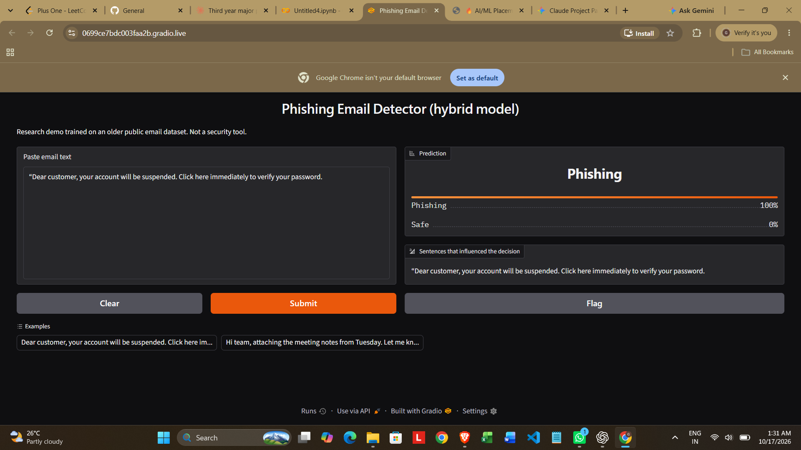

# Phishing Email Detection with a BERT-based Hybrid Deep Learning Model

A phishing email classifier built around DistilBERT, multi-head attention, a 1D CNN and a BiGRU, tuned with Optuna, benchmarked against TF-IDF and plain DistilBERT baselines, with a Gradio demo app included.

## Overview
Inspired by Hosseinzadeh et al., "Improving phishing email detection performance through deep learning with adaptive optimization", *Scientific Reports* 15, 36724 (2025). I reimplemented the idea, tested every component with ablations and multiple seeds, and evaluated on a cleaned, leak-free test set.

## Pipeline
Email text -> DistilBERT embeddings -> multi-head attention -> 1D CNN -> BiGRU -> mean + max pooling -> dense layers -> phishing probability.
Hyperparameters (GRU units, dropout, learning rates) were tuned with Optuna on the validation set. Unlike the paper, the model uses the full token-level BERT output instead of the pooled vector, so attention operates on a real sequence.

## Data
Kaggle "Phishing Emails" dataset: https://www.kaggle.com/datasets/subhajournal/phishingemails (not included in this repo).

Two data-quality problems were found and fixed for the final evaluation:
- about 530 blank emails stored as the text "empty", with essentially random labels
- 242 test emails that also appeared in the training set

The final test set has 3,444 emails with no blanks, no duplicates and no overlap with train or validation.

## Demo


## Results (cleaned test set, 3,444 emails)
| Model | Accuracy | Precision | Recall | F1 | ROC-AUC |
|---|---|---|---|---|---|
| TF-IDF + Logistic Regression | 0.9832 | 0.9790 | 0.9743 | 0.9767 | 0.9971 |
| TF-IDF + SVM | 0.9864 | 0.9800 | 0.9823 | 0.9812 | 0.9976 |
| DistilBERT | 0.9843 | 0.9830 | 0.9735 | 0.9782 | 0.9987 |
| Hybrid (mean of 3 seeds) | 0.9845 | 0.9784 | 0.9789 | 0.9786 | 0.9985 |
| Hybrid without attention | 0.9849 | 0.9869 | 0.9711 | 0.9790 | 0.9990 |
| Hybrid without CNN | 0.9834 | 0.9722 | 0.9823 | 0.9772 | 0.9983 |
| Hybrid without BiGRU | 0.9866 | 0.9808 | 0.9823 | 0.9816 | 0.9982 |

Full-model standard deviation across 3 seeds: F1 +/- 0.0003.

## Key findings
- All models reach 98.3 to 98.7% accuracy. Differences between them are a few emails out of 3,444, which is within noise.
- The hybrid did not beat TF-IDF + SVM or plain DistilBERT on this dataset, so the dataset appears close to saturated.
- No ablated component gives a clear gain; removing the BiGRU did not hurt.
- Cleaning the data changed the results more than any architecture choice.

## Error analysis
Of 53 errors for the best seed (31 false positives, 22 false negatives), false positives were mostly legitimate commercial notices (renewals, refunds, newsletters), and false negatives were mostly casual low-effort spam or very long forwards truncated at 256 tokens. Errors showed no relation to email length.

## Limitations
- The dataset is old (about 2001 to 2004 emails), so results may not transfer to modern or AI-written phishing.
- Text only: no headers, URLs or attachments.
- Inputs are truncated at 256 tokens.
- Single dataset; no cross-dataset evaluation.
- The training set still contains some duplicates and "empty" rows; only the evaluation data was cleaned.
- The demo is a research prototype, not a security product.

## How to run
Python 3.10+ is needed.

```bash
git clone https://github.com/phishing-detection-teamKMCE/phishing-email-detection
cd phishing-email-detection
pip install -r requirements.txt
```

1. Download the dataset from Kaggle (link above) and put `Phishing_Email.csv` in the `data/` folder.
2. Train a model. Pick one:
   - **Fast, CPU, about a minute:** `python -m src.baseline` (TF-IDF + SVM, about 98.6% accuracy)
   - **Full hybrid model, needs a GPU (Google Colab T4, about 40 minutes):** `python -m src.train`
     Ablations: `python -m src.train --no-attn`, `--no-cnn`, `--no-gru`. Other seeds: `--seed 43`.
3. Try it:
   - Command line: `python -m src.predict "Dear customer, verify your password now"`
   - Web demo: `python app.py`, then open http://127.0.0.1:7860

The demo and `predict` use `model.pt` (hybrid) if it exists, otherwise `baseline.joblib`.
Trained weights are not stored in the repo because they are over 250 MB.

### Running on Google Colab (tested)
Set Runtime to T4 GPU, then:
```python
!git clone https://github.com/phishing-detection-teamKMCE/phishing-email-detection
%cd phishing-email-detection
!pip install -q -r requirements.txt
# upload Phishing_Email.csv into the data/ folder, then:
!python -m src.baseline          # about 1 minute
!python -m src.train             # about 7 minutes on a T4
!python -m src.predict "Dear customer, verify your password now"
```
To open the web demo from Colab:
```python
import app
app.demo.launch(share=True)      # prints a public gradio.live link
```
(`!python app.py` does not work on Colab because the local link is not reachable from your browser.)

### Reproduced results
A fresh run of the commands above (cleaned data, 60/20/20 split, 3,505 test emails):

| Model | Accuracy | Precision | Recall | F1 | ROC-AUC |
|---|---|---|---|---|---|
| TF-IDF + SVM (`src.baseline`) | 0.9849 | 0.9794 | 0.9801 | 0.9798 | 0.9986 |
| Hybrid (`src.train`, seed 42) | 0.9866 | 0.9702 | 0.9947 | 0.9823 | 0.9987 |

Both are about 98.5% accurate, so the earlier conclusion holds: the dataset is close to saturated.

Note: `src/data.py` cleans first (removes blank and duplicate emails) and then splits 60/20/20,
so a fresh run gives numbers close to, but not identical with, the table above. The table comes from the
original experiment notebook.

## Repository structure
```
src/
  config.py     settings and the best Optuna hyperparameters
  data.py       load, clean, split
  model.py      DistilBERT + attention + CNN + BiGRU hybrid
  train.py      training and evaluation (supports ablations)
  baseline.py   TF-IDF + SVM baseline
  predict.py    load a trained model and score text
app.py          Gradio demo with sentence-level highlights
notebooks/      original Colab experiment notebook
results/        metrics CSVs
docs/           demo screenshot
notes/          daily progress notes
data/           put the Kaggle CSV here (not tracked)
```

## Tech stack
Python, PyTorch, Hugging Face Transformers, scikit-learn, Optuna, Gradio.

## Author
Gufran Anas, gufrananas23@gmail.com
